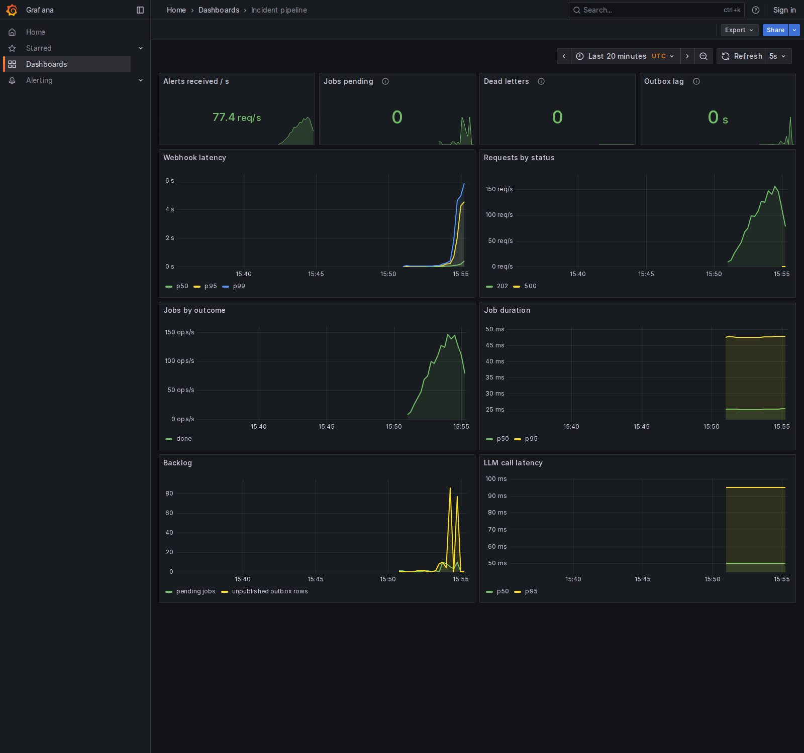

# AI Incident Intelligence Platform

A self-hostable incident copilot. It takes in Prometheus/Alertmanager alerts, groups related alerts into a single incident, gathers the logs, traces, metrics and deploys around it, and uses an LLM to suggest root causes. Every claim it makes points to a piece of collected evidence.

> **Status: early development.** Nothing here is usable yet. The plan and progress are public in [`docs/plan/`](docs/plan/README.md).

## Planned features

- **Alert ingestion** from Alertmanager and a generic JSON webhook, with deduplication
- **Correlation** of related alerts into one incident (time windows, fingerprints, service dependency graph)
- **Enrichment** from Prometheus, Loki and Jaeger around the incident window
- **Root-cause hypotheses** from an LLM, ranked, with citations to specific evidence
- **Similar past incidents** using embeddings (pgvector)
- **Slack notifications**
- **Your choice of model:** Gemini, Claude, or a local model through Ollama, so logs never have to leave your network
- **Measured accuracy:** an evaluation harness scores root-cause accuracy against failures injected into the OpenTelemetry Demo

## How it runs

One Docker image (`iip api` and `iip worker`) plus Postgres with pgvector and Redis. Full self-hosting instructions come with the first release; for now this is the developer setup.

### Local development

Requirements: Docker, [uv](https://docs.astral.sh/uv/), make.

```bash
git clone https://github.com/Parrthh/AI-Incident-Intelligence-Platform.git
cd AI-Incident-Intelligence-Platform
make dev          # API + worker + Postgres + Redis in Docker
curl http://127.0.0.1:8000/readyz
```

To work on the code with tests and type checks:

```bash
make install      # create .venv with dev tools
make check        # lint, type check, tests (integration tests skip without databases)
make help         # all commands
```

| Endpoint | Purpose |
|---|---|
| `GET /healthz` | Liveness: the process is running |
| `GET /readyz` | Readiness: Postgres and Redis are reachable (503 if not) |
| `GET /version` | Package version and git commit of the running build |
| `GET /metrics` | Prometheus metrics: request latency, jobs, queue backlog, outbox lag, LLM calls (Bearer token if `IIP_METRICS_TOKEN` is set) |

### Operating the job queue

Summaries are written by background jobs on a Redis stream ([ADR-0002](docs/adr/0002-redis-streams-queue.md), [ADR-0008](docs/adr/0008-transactional-outbox.md)). Jobs that fail for good land in a dead-letter stream.

```bash
iip queue stats              # stream length, pending jobs, dead letters, workers
iip dlq list                 # newest dead letters with their errors (JSON lines)
iip dlq replay <id> [<id>]   # put dead letters back on the queue (or --all)
iip dlq purge --yes          # delete every dead letter
iip queue prune-consumers    # forget worker names idle for an hour
```

### Load test

The [`Load test` workflow](.github/workflows/load.yml) runs the whole stack on a 4 vCPU GitHub runner and posts alerts at rising rates, each one opening an incident and queueing a summary job (with a stub LLM, so it measures this system and not the model). One API process held 125 to 175 alerts per second depending on the runner's CPU, with p95 webhook latency of 94 to 227 ms at that rate. No alert was lost or summarized twice in 51,664 incidents across three runs. Details and methods are in the [progress log](docs/plan/07_PROGRESS_LOG.md#measured-metrics).



For dashboards, add Prometheus and Grafana to the dev stack:

```bash
docker compose -f deploy/compose/docker-compose.dev.yml \
  -f deploy/compose/docker-compose.observability.yml up -d
# Grafana at http://localhost:3000, dashboard "Incident pipeline"
```

## Project plan

| | |
|---|---|
| [Overview](docs/plan/01_PROJECT_OVERVIEW.md) | Problem, scope, success metrics |
| [Architecture](docs/plan/02_ARCHITECTURE.md) | Components, data model, API |
| [Milestones](docs/plan/04_MILESTONES.md) | Build plan |
| [Progress log](docs/plan/07_PROGRESS_LOG.md) | Current status |

## License

[Apache-2.0](LICENSE)
